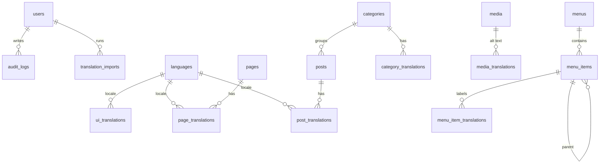

# design.md — Small CMS (Laravel 13 / PHP 8.5 / PostgreSQL)

> เอกสารนี้บอกว่า "ทำอย่างไร" เพื่อให้ตรงกับ `requirement.md` (what)
> อ้างอิง requirement ด้วย ID เช่น `FR-I18N-05`, `NFR-SEC-04`
> โค้ดตัวอย่างในเอกสารเป็น **skeleton/pseudo-code** เพื่อสื่อแนวทาง ต้องตรวจ API ให้ตรงกับ Laravel 13 / PHP 8.5 ตอนเขียนจริง

---

## 0. ข้อตกลงการทำงานสำหรับ AI (AI Working Agreement)

1. **อ่านตามลำดับ**: `requirement.md` → `design.md` → ทำงานตาม Phase ในหัวข้อ 13 ทีละ Phase
2. **หนึ่ง Phase = หนึ่ง branch** (`phase-2-i18n-core`) แล้วค่อย merge ทำงานต่อ commit ใช้รูปแบบ `feat(FR-I18N-05): import preview`
3. **ห้ามเพิ่ม package นอกรายการอนุญาต (หัวข้อ 1.3) โดยไม่ถามก่อน** ถ้าจำเป็นให้เสนอพร้อมเหตุผล แล้วบันทึกใน Decision Log (หัวข้อ 15)
4. ก่อนติดตั้ง package ใด ให้ `composer require` และดูว่ารองรับ Laravel 13 / PHP 8.5 หรือไม่ ถ้าไม่รองรับ **ให้เสนอทางเลือก ห้าม downgrade framework**
5. ทุก string ที่ผู้ใช้เห็น ต้องผ่าน translation key (`__('group.key')`) ห้าม hard-code ภาษาใดภาษาหนึ่งใน view/controller
6. ไม่เขียนข้อมูลลับ (รหัสผ่าน, token) ลง log/audit/exception message
7. เจอสิ่งที่ requirement ไม่ครอบคลุมหรือขัดกัน ให้ **หยุดและถาม** พร้อมเสนอทางเลือก 2-3 ข้อ อย่าเดาเงียบ ๆ
8. จบแต่ละ Phase ต้องผ่าน Definition of Done (requirement.md หัวข้อ 7)

---

## 1. สถาปัตยกรรมและการตัดสินใจหลัก

### 1.1 รูปแบบ

**Monolith แบบ server-rendered** (Laravel + Blade) ทั้งหน้าบ้านและหลังบ้านอยู่ในแอปเดียว ไม่แยก SPA/API

```
Browser ──► Apache ──► PHP (Laravel)
                         ├─ Middleware: SecurityHeaders → SetLocale → Auth/Policy
                         ├─ Controllers (Public / Admin)
                         ├─ Services (Localization, Content, Media)
                         ├─ Eloquent Models ──► PostgreSQL
                         └─ Cache (translations, languages, menus)
```

### 1.2 การตัดสินใจและเหตุผล (Why)

| เรื่อง | เลือก | เหตุผล | ทางเลือกที่ไม่เลือก |
|---|---|---|---|
| UI หน้าบ้าน | Blade + Bootstrap 5 (Vite) ไม่ใช้ Tailwind/Alpine | เว็บองค์กรขนาดเล็กไม่ต้องการ SPA, SEO ดีโดยธรรมชาติ, หน้าบ้าน/หลังบ้านใช้ CSS framework เดียวกันลดความซับซ้อน, Bootstrap JS bundle (มี Popper) พอสำหรับ interactive เล็ก ๆ (เมนูมือถือ, ตัวสลับภาษา) โดยไม่ต้องมี Alpine | Inertia / SPA (เพิ่มความซับซ้อนเกินจำเป็น), Tailwind + Alpine.js (ตัดออกแล้ว ดู Decision Log)
| Livewire | **ไม่ใช้** (ตัดสินใจโดยผู้ใช้) | ทั้งหน้าบ้านและหลังบ้านเป็น Blade + JS ธรรมดา ฟอร์มส่งแบบ request ปกติ | Livewire |
| เนื้อหาหลายภาษา | **ตารางแยก `*_translations`** | slug ต้อง unique ต่อภาษา, ต้อง index/query/ค้นหาต่อภาษา ซึ่ง JSON column ทำได้ลำบากและเสี่ยงข้อมูลสกปรก | JSON column ต่อฟิลด์, package แปลภาษาสำเร็จรูป |
| UI strings | เก็บใน DB + loader ที่ซ้อนทับไฟล์ | ต้องเพิ่มภาษา/แก้คำแปลโดยไม่ deploy (FR-I18N-04/05) | ไฟล์ `lang/*.php` อย่างเดียว (เพิ่มภาษาต้อง deploy) |
| ไฟล์ import | **JSON เท่านั้น** | JSON เป็นข้อมูลล้วน parse ได้ปลอดภัย ส่วนไฟล์ PHP array ต้อง `include` ซึ่งคือการรันโค้ดที่ผู้ใช้อัปโหลด (ช่องโหว่ RCE) | PHP array, .po/XLIFF (เพิ่มภายหลังผ่านตัวแปลงเป็น JSON ได้) |
| Auth | Laravel session guard + Policy | มาตรฐาน ปลอดภัย ไม่ต้องดูแล token | JWT/Sanctum SPA (ไม่จำเป็น) |
| Roles | คอลัมน์ `role` + Gate/Policy | มีแค่ 2 role แพ็กเกจจัดการสิทธิ์เต็มรูปแบบเกินความจำเป็น | spatie/laravel-permission |
| Rich text editor | **TinyMCE** (self-hosted) + **sanitize ฝั่ง server** | Vanilla JS ไม่พึ่ง jQuery จึงไม่ย้อนเพิ่ม dependency ที่ขัดกับ CSP ของ AdminLTE v4, render ใน iframe แยกสไตล์จาก Bootstrap/AdminLTE อยู่แล้ว, ชุมชน/รอบแพตช์ความปลอดภัยใหญ่กว่า, ไม่เชื่อ client (NFR-SEC-04) | Summernote (ต้องพึ่ง jQuery ขัดกับ CSP ของ AdminLTE v4 — ตัดออกแล้ว ดู Decision Log), Tiptap (ตัดออกแล้ว ดู Decision Log), เก็บ HTML ดิบ |
| UI หลังบ้าน | **AdminLTE v4 (Bootstrap 5)** + Blade (ตัดสินใจโดยผู้ใช้) | ทีม front ถนัด, มี component สำเร็จรูป, v4 ไม่ต้องพึ่ง jQuery ทำให้ CSP เข้มได้ง่ายกว่า v3 | AdminLTE v3, เขียน UI เอง, Filament/Nova |
| ภาษาหน้าบ้าน | URL prefix `/{locale}/...` | SEO อยู่ใน TOR: ต้องมี URL ต่อภาษา, hreflang, sitemap แยกภาษา | session อย่างเดียว (บอทเห็นภาษาเดียว) |
| Queue | ยังไม่ใช้ (sync) | ไม่มีงานหนักในรอบแรก import 20,000 คีย์ทำแบบ chunk ใน request เดียวได้ | Redis/Supervisor |
| Timezone | เก็บ UTC (`timestampTz`), แสดงเป็น `Asia/Bangkok` | หลีกเลี่ยงบั๊กเวลา | เก็บเวลาท้องถิ่นใน DB |

### 1.3 Package ที่อนุญาต

| Package | ใช้ทำ |
|---|---|
| `laravel/framework` 13 | แกนหลัก |
| `ezyang/htmlpurifier` (ผ่าน wrapper ตามความเหมาะสม) | sanitize rich text |
| `intervention/image` หรือ Imagick | thumbnail |
| `laravel/pint`, `larastan/larastan` | code style / static analysis |
| `pestphp/pest` หรือ PHPUnit | test |
| `pragmarx/google2fa` | เฉพาะถ้าทำ FR-AUTH-10 |
| Bootstrap 5, TinyMCE (self-hosted, ไม่พึ่ง jQuery) | frontend assets หน้าบ้าน |
| AdminLTE v4 (npm `admin-lte`) + Bootstrap 5 | theme หลังบ้าน (กำหนดแล้ว) ติดตั้งผ่าน npm และ build ด้วย Vite; ตรวจว่า wrapper package (ถ้าจะใช้) รองรับ Laravel 13 ก่อน ไม่งั้นใช้ asset ตรง ๆ + Blade layout ของโปรเจกต์ |

> หน้าบ้านและหลังบ้านใช้ Bootstrap 5 ร่วมกัน แต่ยังแยก Vite entry คนละไฟล์ (คนละ bundle) เพื่อไม่ให้ JS/CSS ของ AdminLTE หลังบ้านรั่วเข้าหน้าบ้าน และคุม CSP/ขนาดไฟล์ของแต่ละฝั่งแยกกันได้

---

## 2. โครงสร้างโปรเจกต์

```
app/
├─ Enums/                 Role, PublishStatus, MenuItemType, TextDirection
├─ Http/
│  ├─ Controllers/
│  │  ├─ Admin/           Auth, Dashboard, Page, Post, Category, Media, Menu,
│  │  │                   Language, UiTranslation, LocalizationImport, User, Setting, AuditLog
│  │  └─ Web/             Home, Page, Post, Sitemap, Robots, Locale
│  ├─ Middleware/         SecurityHeaders, SetLocale (หน้าบ้าน), SetAdminLocale (หลังบ้าน), EnsureUserIsActive
│  └─ Requests/           FormRequest ของทุก endpoint ที่รับข้อมูล
├─ Models/
├─ Policies/
├─ Services/
│  ├─ Localization/       DatabaseTranslationLoader, LocalizationImporter,
│  │                      LocalizationExporter, LocaleRepository, CatalogSyncer
│  ├─ Content/            Sanitizer, SlugGenerator, LocalizedUrlGenerator
│  └─ Media/              MediaUploader
├─ Observers/             AuditObserver
└─ Console/Commands/      l10n:sync, cms:install
database/migrations, database/seeders
lang/                     th/, en/ (catalog ตั้งต้นที่อยู่ใน repo)
resources/views/{admin,web,components,errors}
routes/{web.php, admin.php}
tests/{Feature,Unit}
```

---

## 3. Data Model (PostgreSQL)

### 3.1 ERD



### 3.2 ตาราง

หมายเหตุทั่วไป: PK เป็น `bigIncrements`, เวลาใช้ `timestampsTz`, ข้อมูลที่ลบได้ใช้ `softDeletesTz` (ระบุไว้ต่อตาราง), `locale` เป็น FK ไป `languages.code` (`ON UPDATE CASCADE`, `ON DELETE RESTRICT`)

**users**
| คอลัมน์ | ชนิด | หมายเหตุ |
|---|---|---|
| id | bigint | |
| name | varchar(120) | |
| email | varchar(190) | unique (เก็บ lowercase) |
| password | varchar | hash |
| role | varchar(20) | `admin` / `editor` (Enum) |
| is_active | boolean | default true |
| locale | varchar(12) null | ภาษา UI หลังบ้านของผู้ใช้ |
| last_login_at | timestamptz null | |
| remember_token, timestamps, softDeletes | | |

**languages**
| คอลัมน์ | ชนิด | หมายเหตุ |
|---|---|---|
| code | varchar(12) | **PK** (เช่น `th`, `en`, `zh-CN`) |
| name | varchar(80) | ชื่ออังกฤษ |
| native_name | varchar(80) | ชื่อในภาษานั้น |
| direction | varchar(3) | `ltr`/`rtl` |
| is_default | boolean | partial unique index: มีได้แถวเดียวที่เป็น true |
| is_active | boolean | แสดงที่หน้าบ้านหรือไม่ |
| sort_order | int | |
| timestamps | | |

**ui_translations**
| คอลัมน์ | ชนิด | หมายเหตุ |
|---|---|---|
| id | bigint | |
| locale | varchar(12) | FK languages.code |
| group | varchar(100) | path ของไฟล์ lang ไม่รวม `.php` เช่น `auth`, `admin/common` (มี `/` ได้) |
| key | varchar(190) | ส่วนที่เหลือหลังจุดแรก เช่น `search_placeholder`, `login.title` |
| value | text | plain text |
| updated_by | bigint null | FK users |
| timestamps | | |
| | | **unique (locale, group, key)**, index (locale, group) |

**translation_imports**
id, language_code, filename, file_sha256, mode (ตอนนี้มีเฉพาะ `merge` ดู 6.6), status (`previewed`/`applied`/`failed`), stats (jsonb: added/updated/unchanged/missing/unknown/errors), user_id, created_at, applied_at

**pages / page_translations**
- `pages`: id, template varchar(40) default `default`, status (`draft`/`published`), published_at timestamptz null, is_homepage boolean, sort_order int, created_by, updated_by, timestamps, softDeletes
  - partial unique index: `CREATE UNIQUE INDEX pages_one_homepage ON pages (is_homepage) WHERE is_homepage = true AND deleted_at IS NULL;`
- `page_translations`: id, page_id (FK cascade), locale, title, slug, excerpt null, content text (sanitized HTML), seo_title null, seo_description null, og_image_id null (FK media), noindex boolean default false, timestamps
  - **unique (page_id, locale)**, **unique (locale, slug)**, index (locale, slug)

**posts / post_translations / categories / category_translations**
- `posts`: id, category_id null, cover_media_id null, status, published_at, created_by, updated_by, timestamps, softDeletes
- `post_translations`: id, post_id, locale, title, slug, excerpt, content, seo_title, seo_description, og_image_id null, noindex boolean default false — unique (post_id, locale), unique (locale, slug)
- `categories`: id, sort_order, timestamps; `category_translations`: category_id, locale, name, slug — unique (locale, slug)
- index posts (status, published_at DESC) สำหรับหน้ารายการ

> slug ของ page และ post อยู่คนละตาราง แต่ใช้ URL space ต่างกัน (`/{locale}/{slug}` กับ `/{locale}/posts/{slug}`) จึงไม่ชนกัน ดูหัวข้อ 4.2 เรื่อง reserved slugs

**media / media_translations**
- `media`: id, disk, path, original_name, mime_type, size_bytes, width null, height null, sha256, uploaded_by, timestamps, softDeletes
- `media_translations`: media_id, locale, alt_text — unique (media_id, locale)

**menus / menu_items / menu_item_translations**
- `menus`: id, key (unique: `header`, `footer`), timestamps
- `menu_items`: id, menu_id, parent_id null (ลึกสุด 2 ระดับ ตรวจใน validation), type (`page`/`post`/`url`), page_id null, post_id null, url null, sort_order, is_active
  - CHECK constraint ให้ตรงกับ type (เช่น type=`url` ต้องมี url)
- `menu_item_translations`: menu_item_id, locale, label — unique (menu_item_id, locale)

**settings**
key varchar, locale varchar null (null = ไม่ขึ้นกับภาษา), value jsonb — **unique (key, COALESCE(locale,''))** (สร้างเป็น expression unique index ด้วย `DB::statement`)

**redirects** (FR-SEO-05/06)
id, from_path varchar(500) (เก็บ path ที่ normalize แล้ว รวม locale prefix เช่น `/en/about-us`), to_path varchar(500), status_code smallint default 301, is_auto boolean (สร้างโดยระบบ), hit_count int default 0, last_hit_at null, created_by null, timestamps — **unique (from_path)**

**audit_logs**
id, user_id null, action varchar(60), subject_type null, subject_id null, changes jsonb null (ห้ามมี field ลับ), ip inet null, user_agent varchar(255) null, created_at — index (subject_type, subject_id), index (created_at)

---

## 4. Routing และการกำหนดภาษา

### 4.1 โครงสร้าง route

```
# routes/admin.php  (prefix /admin, name admin., ประกาศก่อน routes/web.php)
GET  /admin/login, POST /admin/login, POST /admin/logout
GET  /admin/forgot-password ... reset-password (FR-AUTH-03)
GET  /admin                             dashboard
resource pages, posts, categories, media, menus   (Editor + Admin)
resource users, languages                         (Admin)
GET/PUT /admin/translations             UI strings editor
GET/POST /admin/localization/import     upload + preview + confirm
GET  /admin/localization/export/{code}  ?mode=current|template
GET/PUT /admin/settings, GET /admin/audit-log     (Admin)

# routes/web.php (หน้าบ้าน)
GET /lang/{locale}            → สลับภาษา (route เดิม ใช้กับหลังบ้านเป็นหลัก ดู 4.5) name: lang.switch
GET /                         → redirect ไป /{default_locale}
GET /sitemap.xml, GET /robots.txt
GET /{locale}                 → home (หน้าที่ is_homepage)
GET /{locale}/posts           → รายการ posts (paginate)
GET /{locale}/posts/{slug}    → post
GET /{locale}/{slug}          → page   (ประกาศท้ายสุด)
```

### 4.2 กฎของ locale และ slug

- พารามิเตอร์ `{locale}` ถูกจำกัดด้วย constraint และตรวจกับรายการภาษา **active** จาก `LocaleRepository` (cache) ใน middleware `SetLocale`; ไม่ตรง → 404
- `admin` ห้ามเป็น locale code (reserved) กันชนกับ prefix หลังบ้าน
- Reserved slugs ของ page: `posts`, `admin`, `sitemap.xml`, `robots.txt`, `search` ตรวจใน FormRequest (ภายหลังเพิ่มได้ผ่าน config)
- `SetLocale`: `app()->setLocale($locale)` และตั้ง `fallback_locale` เป็นภาษา default จาก DB (FR-I18N-18)
- หลังบ้านเลือกภาษาจาก `users.locale` → session → ภาษา default

### 4.5 สลับภาษา: หลังบ้านใช้ session, หน้าบ้านใช้ URL prefix

โปรเจกต์เดิมสลับภาษาด้วย route `lang.switch` + `session('locale')` ซึ่ง **เหมาะกับหลังบ้าน** (ไม่มี SEO, URL เดียว) ให้คงไว้ แต่ปรับ 2 จุด

```php
// pseudo-code
Route::get('/lang/{locale}', function (string $locale, LocaleRepository $repo) {
    if (in_array($locale, $repo->activeCodes(), true)) {   // แทน ['th','en'] ที่ hard-code
        session(['locale' => $locale]);
        auth()->user()?->update(['locale' => $locale]);    // จำค่าไว้ข้ามอุปกรณ์ (ถ้าล็อกอินอยู่)
    }
    return redirect()->back();
})->middleware('throttle:30,1')->name('lang.switch');
```

- เหตุผลที่ต้องเลิก hard-code `['th','en']`: ภาษาที่เพิ่มด้วยการ import จะสลับไม่ได้ถ้ายังเช็คกับ array ในโค้ด
- `SetAdminLocale` เลือกภาษาหลังบ้านตามลำดับ: `session('locale')` → `users.locale` → ภาษา default
- **หน้าบ้านไม่ควรใช้ session อย่างเดียว**: URL เดียวแต่เนื้อหาเปลี่ยนตาม session ทำให้ Google เห็นแค่ภาษาเดียว, แชร์ลิงก์แล้วได้คนละภาษา, และ hreflang ทำไม่ได้ (FR-I18N-12/15) จึงใช้ prefix `/{locale}/...` ที่หน้าบ้าน และให้ตัวสลับภาษาที่หน้าบ้านเป็นลิงก์ไปยัง URL ของภาษานั้นโดยตรง (ผ่าน `LocalizedUrlGenerator`)
- **ตัดสินใจแล้ว**: SEO อยู่ใน TOR จึงใช้ URL prefix ที่หน้าบ้านแน่นอน ส่วน route `/lang/{locale}` ใช้กับหลังบ้านเท่านั้น (หน้าบ้านตัวสลับภาษาเป็นลิงก์ตรงไป URL ของแต่ละภาษา)

### 4.3 SlugGenerator

`Str::slug()` ของ Laravel ตัดตัวอักษรไทยทิ้ง ดังนั้นต้องมี `SlugGenerator` ของโปรเจกต์:
- รองรับ Unicode letters/numbers (`\p{L}\p{N}`), แทนช่องว่างด้วย `-`, lowercase, ตัดอักขระพิเศษ
- ผู้ดูแลแก้ slug เองได้ ตรวจ unique ต่อ `(locale, slug)` และไม่ชน reserved
- URL ที่เป็นภาษาไทยถูก percent-encode อัตโนมัติ ใช้ `rawurlencode` ตอนสร้างลิงก์/sitemap

### 4.4 LocalizedUrlGenerator

ให้ model ที่มีคำแปล (Page/Post) ส่งออก `[locale => url]` เฉพาะภาษาที่ **active และมีคำแปลที่ Published** ใช้สำหรับ:
- ตัวสลับภาษา (FR-I18N-14), `<link rel="alternate" hreflang>` (FR-I18N-15), sitemap (FR-WEB-04)
- ใส่ `x-default` ชี้ไปภาษา default

---

## 5. Authentication และ Authorization

### 5.1 Auth (FR-AUTH-*)

- ใช้ session guard มาตรฐาน; จะใช้ starter kit ของ Laravel หรือเขียนเองก็ได้ แต่ต้องปรับให้ตรงกับ FR-AUTH ทุกข้อ และตัดส่วนที่ไม่ต้องการ (เช่น สมัครสมาชิกสาธารณะ — **ต้องปิด**)
- Login: `RateLimiter` กุญแจ `lower(email)|ip` จำกัด 5 ครั้ง/นาที → 429; ข้อความ error เดียวสำหรับทั้ง "ไม่มีผู้ใช้" และ "รหัสผ่านผิด" (FR-AUTH-04)
- หลังล็อกอินสำเร็จ `session()->regenerate()`; ล็อกเอาต์ `invalidate()` + `regenerateToken()`
- Middleware `EnsureUserIsActive`: ถ้า `is_active=false` → logout ทันที (FR-AUTH-06)
- Session: `SESSION_LIFETIME=120`, `SESSION_SECURE_COOKIE=true`, `SESSION_HTTP_ONLY=true`, `SESSION_SAME_SITE=lax`
- Password: `Password::min(12)->uncompromised()` (FR-AUTH-09), เปลี่ยนรหัสผ่านต้องใส่รหัสเดิม (FR-AUTH-05)
- Reset password: ใช้ broker มาตรฐาน token อายุสั้น (เช่น 60 นาที) และ throttle
- ป้องกัน Admin คนสุดท้าย (FR-AUTH-07) ทำใน `UserPolicy` + `UserService` (ตรวจจำนวน admin ที่ active ก่อน demote/disable/delete) พร้อม test

### 5.2 Authorization

| Gate/Policy | Admin | Editor |
|---|---|---|
| `PagePolicy`, `PostPolicy`, `CategoryPolicy`, `MediaPolicy`, `MenuPolicy` | ✔ | ✔ |
| `manage-users`, `manage-languages`, `manage-translations`, `manage-settings`, `view-audit-log` | ✔ | ✘ (403) |

- กลุ่ม route ฝั่ง Admin ใช้ middleware `auth` + `EnsureUserIsActive`; แต่ละ controller เรียก `$this->authorize()`/Policy เสมอ (NFR-SEC-03)

---

## 6. ออกแบบระบบหลายภาษา (หัวใจ)

### 6.1 สองชั้นของคำแปล

| ชั้น | เก็บที่ | แก้โดย | ใช้ผ่าน |
|---|---|---|---|
| UI strings | `ui_translations` | Admin (Translations editor / Import) | `__('auth.login.title')` |
| Content translations | `*_translations` | Admin/Editor (แท็บภาษาในฟอร์ม) | relation ของ model |

### 6.2 Convention ของ UI string key

- รูปแบบเดียวกับ Laravel และโปรเจกต์เดิม: **`group.key`** โดย group = path ไฟล์ใต้ `lang/{locale}/` (ไม่รวม `.php`) ซึ่ง **มี `/` ได้** และ key คือส่วนหลังจุดแรก เช่น
  - `admin/common.search_placeholder` → group `admin/common`, key `search_placeholder`
  - `validation.required` → group `validation`, key `required`
  - ไฟล์ `lang/th/admin/common.php` ที่เป็น `return ['search_placeholder' => 'ค้นหา...']` สอดคล้องกันพอดี (Laravel `FileLoader` รองรับ group แบบมี `/` อยู่แล้ว)
- **ห้าม** ใช้ประโยคเป็นคีย์ (แบบ JSON `__('Save')`) เพื่อให้ import/validate ได้สม่ำเสมอ
- ค่าเป็น plain text มี placeholder แบบ Laravel (`:name`, `:count`) และ pluralization (`a|b`) ได้
- คีย์ห้ามเป็น "พ่อ" ของคีย์อื่น (เช่นมีทั้ง `a.b` และ `a.b.c`) เพราะ `Arr::undot` จะชนกัน → import ปฏิเสธ
- Catalog (ชุดคีย์ที่ระบบรู้จัก) = คีย์ของ **ภาษา default** ใน DB

### 6.3 DatabaseTranslationLoader

ห่อ (decorate) `FileLoader` ของ Laravel:

```php
// pseudo-code — ตรวจ interface Illuminate\Contracts\Translation\Loader ให้ตรงเวอร์ชันจริง
final class DatabaseTranslationLoader implements Loader
{
    public function __construct(private Loader $files, private LocaleRepository $repo) {}

    public function load($locale, $group, $namespace = null): array
    {
        $fromFiles = $this->files->load($locale, $group, $namespace);
        if ($namespace !== null && $namespace !== '*') {
            return $fromFiles;              // package namespaces ใช้ไฟล์ตามเดิม
        }
        $fromDb = $this->repo->uiStrings($locale, $group);   // cached, คืน array แบบ dot
        return array_replace_recursive($fromFiles, Arr::undot($fromDb));
    }
    // addNamespace / addJsonPath / namespaces → delegate ไป $this->files
}

// AppServiceProvider::register()
$this->app->extend('translation.loader', fn ($loader, $app) =>
    new DatabaseTranslationLoader($loader, $app->make(LocaleRepository::class)));
```

พฤติกรรม: ค่าจาก DB **ทับ** ค่าจากไฟล์; คีย์ที่ไม่มีในภาษาที่ขอจะ fallback ผ่านกลไก `fallback_locale` ของ Laravel (ตั้งเป็นภาษา default)

### 6.4 CatalogSyncer (`php artisan l10n:sync`)

- อ่าน `lang/{locale}/**/*.php` (**วนเข้าโฟลเดอร์ย่อย** เช่น `admin/`) ของภาษาในรีโป (ตอนนี้ `th`, `en`) กำหนด group จาก path สัมพัทธ์ แล้ว flatten (`Arr::dot`) → upsert เฉพาะ **คีย์ที่ยังไม่มีใน DB** (ไม่ทับค่าที่ผู้ดูแลแก้ไว้)
- รันใน `cms:install` และใน deploy script ทุกครั้ง เพื่อให้คีย์ใหม่จากโค้ดเข้า DB
- **ไฟล์ `lang/th`, `lang/en` ที่ทำไว้แล้วในโปรเจกต์เดิม (PHP array) ใช้เป็น catalog ตั้งต้นได้เลย** แค่ย้ายเข้ารีโปนี้แล้วรัน `l10n:sync` ไม่ต้องแปลงรูปแบบ
- ไม่รองรับไฟล์ JSON แบบประโยคเป็นคีย์ (`__('Save')`) ในโปรเจกต์นี้ ตาม convention 6.2
- เริ่มต้นด้วย `php artisan lang:publish` เพื่อได้ไฟล์ตั้งต้น (validation/auth/pagination/passwords) แล้วแปลไทยเอง

### 6.5 รูปแบบไฟล์ Import/Export (JSON)

```json
{
  "meta": {
    "schema_version": 1,
    "locale": "ja",
    "name": "Japanese",
    "native_name": "日本語",
    "direction": "ltr"
  },
  "strings": {
    "auth.login.title": "ログイン",
    "admin/common.search_placeholder": "検索...",
    "validation.required": ":attribute は必須です。"
  }
}
```

กฎการตรวจ (FR-I18N-09, NFR-SEC-07):

| กฎ | ค่า | ระดับ |
|---|---|---|
| นามสกุล/ชนิด | `.json`, MIME `application/json` หรือ `text/plain`, เนื้อไฟล์ต้อง decode ได้ | error |
| ขนาดไฟล์ | ≤ 2 MB | error |
| จำนวนคีย์ | ≤ 20,000 | error |
| `json_decode` | `JSON_THROW_ON_ERROR`, depth ≤ 5, ห้าม key ซ้ำ | error |
| `schema_version` | ต้องรองรับ (ตอนนี้ = 1) | error |
| `meta.locale` | regex `^[a-z]{2,3}(-[A-Za-z0-9]{2,8})?$`, ไม่ใช่ reserved (`admin`, `api`, ...) | error |
| รูปแบบคีย์ | `^[a-z0-9_\-]+(/[a-z0-9_\-]+)*\.[A-Za-z0-9_\-]+(\.[A-Za-z0-9_\-]+)*$` (group มี `/` ได้ เช่น `admin/common.search_placeholder`), ไม่เป็น "พ่อ" ของคีย์อื่น | error |
| ค่า | string, ความยาว ≤ 2,000, ไม่มี control char, **ไม่มี HTML tag** (`/<\/?[a-z][^>]*>/i`) | error |
| Placeholder | เซตของ `:[A-Za-z_]\w*` ต้องเท่ากับของภาษา default ของคีย์เดียวกัน | error |
| คีย์ที่ไม่รู้จัก (ไม่อยู่ใน catalog) | ข้ามและรายงาน | warning |
| คีย์ที่ขาด (อยู่ใน catalog แต่ไม่มีในไฟล์) | รายงานเป็น % ที่ครบ | warning |
| ค่าว่าง `""` | ถือว่ายังไม่แปล ไม่นำเข้า | info |

### 6.6 ขั้นตอน Import (FR-I18N-05/07/08)

```
1 Upload  → เก็บไฟล์ชั่วคราวใน private disk (ชื่อสุ่ม), คำนวณ sha256
2 Parse   → json_decode แบบข้อมูลล้วน (ห้าม include/eval/unserialize)
3 Validate→ ตามตาราง 6.5 สะสม error ทั้งหมด (ไม่หยุดที่ตัวแรก)
4 Diff    → เทียบกับ DB: added / updated / unchanged / missing / unknown
5 Preview → แสดงผล + บันทึก translation_imports(status=previewed)
            ถ้ามี error → ปุ่มยืนยันถูกปิด
6 Confirm → ตรวจ sha256 ตรงกับตอน preview (กันไฟล์ถูกสลับ)
            DB::transaction:
              - ถ้าภาษาใหม่ → สร้าง languages (is_active=false, is_default=false)
              - bulk upsert ui_translations เป็น chunk (เช่น 1,000) ด้วย unique (locale, group, key)
              - mode merge (ค่าเริ่มต้น): แตะเฉพาะคีย์ที่อยู่ในไฟล์
              - อัปเดต translation_imports(status=applied, stats)
            หลัง commit → bump cache version ของภาษา + audit log
7 ล้มเหลว → rollback ทั้งหมด (FR-I18N-08), status=failed
```

- ภาษาที่ import ใหม่ **ปิดอยู่ก่อน** เพื่อไม่ให้ภาษาที่แปลไม่ครบหลุดไปหน้าบ้าน ผู้ดูแลตรวจ % ความครบแล้วค่อยกดเปิด (FR-I18N-16)
- ไม่ทำโหมด `replace` (ลบคีย์ที่ไม่อยู่ในไฟล์) ในรอบแรก เพราะเสี่ยงลบคำแปลโดยพลาด หากต้องการให้เสนอเป็นงานแยก
- Export (FR-I18N-06): `mode=current` ส่งคำแปลปัจจุบันของภาษานั้น, `mode=template` ส่งคีย์ทั้งหมดของ catalog พร้อมข้อความของภาษา default เป็นต้นฉบับให้ผู้แปล
- ถ้าลูกค้ามีไฟล์รูปแบบอื่น (Q3) ให้เพิ่ม "Converter" ที่แปลงเป็นโครงสร้างเดียวกับ JSON ข้างบนแล้วเข้า pipeline เดิม ห้ามเปิดทางให้รันโค้ดจากไฟล์อัปโหลด

### 6.7 Cache

- ใช้ **version key** แทน cache tags (ใช้ได้กับทุก driver): `l10n:v:{locale}` เก็บเลขเวอร์ชัน, ข้อมูลเก็บที่ `l10n:{locale}:{version}:{group}` ด้วย `Cache::rememberForever`
- แก้/import คำแปลของภาษาใด → เพิ่มเลขเวอร์ชันของภาษานั้น (คีย์เก่าหมดอายุเอง)
- `languages.active`, `menus.{key}.{locale}`, `settings` cache ด้วยวิธีเดียวกัน ล้างเมื่อมีการแก้ไข

### 6.8 Content translation

- ฟอร์มแก้ไข Page/Post มีแท็บตามภาษา **active** แต่ละแท็บบันทึกเป็นแถวใน `*_translations`
- ภาษาที่ไม่กรอก title = ไม่มีคำแปลภาษานั้น (ไม่สร้างแถวว่าง)
- อย่างน้อยต้องมีคำแปลของภาษา default ถึงจะบันทึก/เผยแพร่ได้
- หน้าบ้าน: ไม่มีคำแปลในภาษาที่ร้องขอ → 404 (ตาม Q4), ตัวสลับภาษาข้ามไปหน้าแรกของภาษานั้น

### 6.9 ความครบของคำแปล (FR-I18N-16)

`completeness = จำนวนคีย์ใน catalog ที่ภาษานั้นมีค่าไม่ว่าง / จำนวนคีย์ใน catalog` คำนวณด้วย SQL เดียว (join/group) และ cache ตามเวอร์ชันภาษา

---

## 7. โมดูลเนื้อหา

- **Rich text**: บันทึกผ่าน `Sanitizer` (HTMLPurifier) ด้วย allowlist เช่น `p, h2-h4, ul, ol, li, strong, em, a[href|title|rel|target], img[src|alt], blockquote, table*, br` บังคับ `rel="noopener noreferrer"` เมื่อ `target=_blank` อนุญาตเฉพาะ scheme `http/https/mailto/tel` รูปใน content ต้องอ้างถึง media ของระบบ
- **Media**: `MediaUploader` — ตรวจ MIME จากเนื้อไฟล์ (finfo), จำกัดชนิด (jpg/png/webp/gif/pdf), จำกัดขนาด (เช่น 10 MB), ตั้งชื่อใหม่ด้วยค่าสุ่ม (ไม่ใช้ชื่อไฟล์ผู้ใช้ใน path), แยกโฟลเดอร์ตามปี/เดือน, สร้าง thumbnail (FR-MEDIA-03), **ไม่รับ SVG**
- **Menus**: เก็บเป็นต้นไม้ 2 ระดับ ลำดับด้วย `sort_order`; หน้าบ้านดึงเมนูพร้อมแปลงลิงก์ผ่าน `LocalizedUrlGenerator` และซ่อนรายการที่เป้าหมายไม่มีคำแปลในภาษานั้น
- **Settings**: อ่านผ่าน helper `setting('site.name')` (ใช้ locale ปัจจุบัน → fallback ค่า locale=null → ค่า default)
- **Audit**: `AuditObserver` ผูกกับ model สำคัญ + event login/logout/import; กรอง field ที่ห้ามบันทึก (`password`, `remember_token`)

---

## 8. หน้าบ้าน (Public)

- Layout เดียว (`layouts/web.blade.php`) มี header (เมนู + ตัวสลับภาษา), footer, ส่วน `<head>` ที่สร้าง `lang`, `dir`, meta, canonical, hreflang, Open Graph
- Template ของ page: `default` (ขยายเพิ่มภายหลังผ่านคอลัมน์ `template`)
- Responsive ด้วย Bootstrap 5 grid/utilities, semantic HTML, `alt` ครบ, focus ที่มองเห็น, ลิงก์ข้ามไปเนื้อหา (NFR-A11Y-01)
- Pagination ของ posts: 10 รายการ/หน้า ใช้ `published_at DESC` + eager load translations (กัน N+1)
- `sitemap.xml` สร้างตอนเรียกแล้ว cache (ล้างเมื่อเนื้อหาเปลี่ยน) ครบทุกภาษา พร้อม `xhtml:link` สลับภาษา
- หน้า error `errors/404.blade.php`, `500.blade.php` ใช้ locale ปัจจุบัน (ถ้า resolve ไม่ได้ใช้ภาษา default) และ **ต้องตอบ status 404/500 จริง** (FR-SEO-12)

### 8.1 SEO Design (FR-SEO-*)

บริการกลาง `SeoData` (value object) + component `<x-seo :data="$seo" />` ที่ render ส่วน `<head>` ทั้งหมด controller แต่ละหน้าสร้าง `SeoData` จาก model เดียวกันเสมอ เพื่อให้ทุกหน้าใช้กติกาเดียว

| เรื่อง | วิธีทำ |
|---|---|
| Render (SEO-01) | Blade ฝั่ง server ทั้งหมด; JS ใช้เสริมเท่านั้น (เมนูมือถือ, สลับ UI) เนื้อหาหลักต้องอยู่ใน HTML ที่ response แรก |
| Title/description (SEO-02) | `seo_title ?? "{title} \| {site.name}"`, `seo_description ?? Str::limit(strip_tags(excerpt ?? content), 160)`; แสดงตัวนับตัวอักษรในฟอร์มหลังบ้าน |
| Canonical (SEO-03) | absolute URL ของภาษานั้นจาก `LocalizedUrlGenerator` ตัด query ที่ไม่เกี่ยวข้อง; หน้า paginate ชี้ canonical เป็นหน้านั้นเอง (`?page=2` → ตัวเอง ไม่ชี้หน้า 1) |
| hreflang (SEO-03) | `LocalizedUrlGenerator::alternates()` คืนเฉพาะภาษา active ที่มีคำแปลที่ Published และไม่ noindex + self-reference + `x-default` (ภาษา default) ทุกหน้าในกลุ่มต้องออกเซตเดียวกัน (reciprocal) |
| URL (SEO-04) | lowercase, ไม่มี trailing slash; middleware `NormalizeUrl` 301 กรณี slash ท้าย/ตัวพิมพ์ใหญ่/`/index.php`; HTTP→HTTPS และ non-www/www รูปแบบเดียวทำที่ Apache |
| Redirects (SEO-05/06) | `RedirectObserver` สร้างแถว `redirects` อัตโนมัติเมื่อ slug ของ page/post เปลี่ยน (from = URL เก่า, to = URL ใหม่) และอัปเดตแถวเดิมที่ชี้มาที่ URL เก่าให้ชี้ปลายทางใหม่ (กัน redirect chain); middleware `HandleRedirects` ทำงานเมื่อไม่พบ route/model → ค้นตาราง `redirects` ก่อนตอบ 404; ตรวจ loop ตอนบันทึก; cache ตาม version key |
| Sitemap (SEO-07) | `sitemap.xml` ประกอบด้วย pages/posts ที่ Published, ไม่ noindex, ถึงเวลาเผยแพร่; ทุก `<url>` มี `lastmod` (จาก `updated_at`) และ `xhtml:link` สลับภาษา; cache + ล้างเมื่อเนื้อหาเปลี่ยน; ถ้า URL เกิน 50,000 แยกเป็น sitemap index |
| robots.txt | `Disallow: /admin`, `Disallow: /lang/`, ระบุ `Sitemap:` เป็น absolute URL; บน staging ตอบ `Disallow: /` (ตั้งด้วย `APP_ENV`) |
| noindex (SEO-10) | `<meta name="robots" content="noindex,follow">` เมื่อ `noindex=true`; หลังบ้านส่ง header `X-Robots-Tag: noindex, nofollow` ผ่าน middleware ของกลุ่ม admin |
| Open Graph (SEO-08) | `og:title/description/url/type/site_name/locale` + `og:locale:alternate` ตามภาษาที่มี, `og:image` จาก `og_image_id` (fallback รูปปกของ post → รูปเริ่มต้นใน settings), `twitter:card=summary_large_image` |
| JSON-LD (SEO-09) | service `JsonLd`: Organization + WebSite (หน้าแรก), Article/BlogPosting (headline, datePublished, dateModified, image, inLanguage, author/publisher), BreadcrumbList; สร้างด้วย `json_encode(..., JSON_HEX_TAG\|JSON_HEX_AMP\|JSON_UNESCAPED_UNICODE\|JSON_UNESCAPED_SLASHES)` ใน `<script type="application/ld+json">` เพื่อกัน `</script>` จากข้อมูลผู้ใช้ |
| Semantic (SEO-11) | template บังคับ `<h1>` = title; heading ใน content ที่ editor สร้างเริ่มที่ `h2` (allowlist ของ Sanitizer ไม่รวม `h1`); alt ว่าง → แสดงคำเตือนในหลังบ้านตอนบันทึก |
| Status (SEO-12) | Draft/ยังไม่ถึงเวลา/ภาษาไม่มีคำแปล → `abort(404)` จริง ห้ามตอบ 200 ด้วยหน้า error |

**Performance สำหรับ Core Web Vitals (FR-SEO-13)**
- Vite build (minify, hash filename) หน้าบ้านโหลด CSS/JS น้อยที่สุด; ไม่โหลด AdminLTE/Bootstrap ในหน้าบ้าน
- Apache: `mod_deflate` (หรือ brotli) + `mod_expires`/`Header` ให้ไฟล์ใน `/build/` และ `/storage/` ที่มี hash หรือไม่เปลี่ยน cache ยาว (`Cache-Control: public, max-age=31536000, immutable` เฉพาะไฟล์ที่มี hash)
- รูป: สร้างขนาดหลายขนาด + WebP, ใส่ `width`/`height` เสมอ (กัน CLS), `loading="lazy"` ยกเว้นรูป LCP (รูปแรกบนจอใช้ `fetchpriority="high"`)
- ฟอนต์: self-host, `font-display: swap`, preload เฉพาะตัวที่ใช้ในจอแรก
- Query: eager loading, index ตามหัวข้อ 3; cache เมนู/settings/ภาษา (หัวข้อ 6.7); ถ้าจำเป็นเพิ่ม response cache ของหน้า public (ล้างเมื่อเนื้อหาเปลี่ยน)
- ตรวจด้วย Lighthouse CI กับหน้าตัวอย่าง (home, page, post list, post) ใน pipeline (FR-SEO-14)

---

## 9. หลังบ้าน (Admin UI)

เมนูข้าง: Dashboard · Pages · Posts · Categories · Media · Menus · Languages (รายการภาษา / Translations / Import-Export) · Users · Settings · Audit log

หน้าสำคัญของ i18n:
- **Languages**: ตารางภาษา + % ความครบ + สวิตช์เปิด/ปิด + ตั้ง default + จัดลำดับ (drag หรือปุ่มขึ้น/ลง)
- **Translations editor**: เลือกภาษา → ตารางคีย์ (กรองตามกลุ่ม, ค้นหา, "เฉพาะที่ยังไม่แปล"); แสดงข้อความภาษา default ข้างช่องแก้ไข; บันทึกเป็นชุดต่อกลุ่ม; แสดง placeholder ที่ต้องคงไว้
- **Import**: ขั้นตอนเป็น stepper 3 ขั้น (อัปโหลด → Preview → ยืนยัน) ตาราง Preview แยก added/updated/unknown/missing/error พร้อมปุ่มดาวน์โหลดรายงาน error
- **Export**: ปุ่มดาวน์โหลดของแต่ละภาษา + ปุ่ม "template" สำหรับผู้แปล

หลังบ้านสร้างบน **AdminLTE v4 (Bootstrap 5, ไม่มี jQuery)**: layout หลักเป็น `layouts/admin.blade.php` ที่ใช้ sidebar/navbar/card/table ของ AdminLTE, ตัวสลับภาษาอยู่ที่ navbar (ลิงก์ไป `lang.switch`) ส่วนที่ AdminLTE ไม่มีให้ ทำเป็น Blade component ของโปรเจกต์ (`x-admin.locale-tabs` สำหรับแท็บภาษาในฟอร์ม, `x-admin.import-stepper`) ฟอร์มทั้งหมดส่งแบบ request ปกติ ไม่ใช้ Livewire

ฟอร์มแก้ไข Page/Post มีส่วน **SEO** ต่อแท็บภาษา: seo_title, seo_description (พร้อมตัวนับตัวอักษรและตัวอย่างผลค้นหา), og image, noindex, slug, และแสดงรายการ redirect ที่ชี้มาหน้านี้ เมนู **Redirects** ใน Admin ใช้จัดการ FR-SEO-06

ข้อควรระวังของ AdminLTE: เลี่ยง inline script/handler ให้มากที่สุด และเก็บ JS ของโปรเจกต์เป็นไฟล์ที่ build ผ่าน Vite เพื่อให้ CSP ของหลังบ้านยังเข้มพอ (ดู SEC-08)

---

## 10. Security Design (ผูกกับ NFR-SEC)

| NFR | วิธีทำ |
|---|---|
| SEC-01 CSRF | `@csrf` ทุกฟอร์ม, ไม่ปิด middleware ของ `web` |
| SEC-02 | `Hash` มาตรฐาน, ไม่ log password; `$hidden` ใน model |
| SEC-03 | Policy ทุก controller + test ที่ยืนยัน 403 ของ Editor |
| SEC-04 | `Sanitizer` ก่อนบันทึก rich text + test ด้วย payload XSS ทั่วไป |
| SEC-05 | UI strings render ด้วย `{{ }}` เท่านั้น; code review/PHPStan rule ห้าม `{!! __() !!}`; ถ้าต้องมีข้อความที่มีลิงก์ ให้ใช้ pattern แยกส่วน (ข้อความ + ลิงก์ใน view) |
| SEC-06 | `MediaUploader` ตามหัวข้อ 7 + ปิดการ execute สคริปต์ในโฟลเดอร์อัปโหลดที่ Apache (หัวข้อ 12) |
| SEC-07 | ตารางกฎหัวข้อ 6.5, `JSON_THROW_ON_ERROR`, ไม่มี `include/eval/unserialize` บนไฟล์อัปโหลด |
| SEC-08 | Middleware `SecurityHeaders`: `Content-Security-Policy` (default-src 'self'; script-src 'self' พร้อม nonce ถ้าจำเป็น; img-src 'self' data:; object-src 'none'; base-uri 'self'; frame-ancestors 'none'), `X-Content-Type-Options: nosniff`, `Referrer-Policy: strict-origin-when-cross-origin`, `Permissions-Policy`, HSTS เมื่อ HTTPS; **แยก policy 2 ชุด**: หน้าบ้านเข้มสุด, หลังบ้านผ่อนเท่าที่ AdminLTE v4/Bootstrap 5 ต้องใช้จริง (เช่น nonce สำหรับ inline ที่จำเป็น; v4 ไม่ใช้ jQuery จึงเข้มได้ใกล้เคียงหน้าบ้าน) และห้าม `unsafe-eval` ทั้งสองชุด |
| SEC-09 | ตั้งค่า `config/session.php` ตามหัวข้อ 5.1 |
| SEC-10 | Eloquent/Query Builder เท่านั้น; `orderBy` ด้วยค่าจาก allowlist; raw SQL ต้อง bind parameter |
| SEC-11 | `APP_DEBUG=false`, `.env` นอก DocumentRoot, สิทธิ์ไฟล์ `.env` 640 |
| SEC-12 | CI: `composer audit`, `composer.lock` ถูก commit |
| SEC-13 | ผู้ใช้ DB เฉพาะแอป (CRUD บน schema ของแอป); migration รันด้วยบัญชีแยกถ้าทำได้ |

เพิ่มเติม: ทุกฟอร์มมี throttle ตามสมควร, ข้อความ error ไม่เปิดเผยรายละเอียดภายใน, การดาวน์โหลด export ต้องผ่าน Policy

---

## 11. กลยุทธ์การทดสอบ

- **Test DB เป็น PostgreSQL จริง** (ไม่ใช้ SQLite) เพราะใช้ partial index, jsonb, expression index
- ลำดับความสำคัญของ test:
  1. **AUTH**: login สำเร็จ/ผิด, rate limit 429, user inactive, Editor เข้าหน้า Admin-only ได้ 403, Admin คนสุดท้าย (FR-AUTH-04/06/07)
  2. **I18N Import**: ไฟล์ถูกต้อง → เพิ่มภาษา; placeholder ไม่ตรง; `.php` ถูกปฏิเสธ; ไฟล์ใหญ่เกิน; JSON พัง; key พ่อ-ลูกชน; transaction rollback เมื่อ error; sha256 ไม่ตรงตอน confirm (FR-I18N-05..09)
  3. **Locale routing**: prefix ภาษา, ภาษาปิดแล้ว 404, redirect `/`, hreflang, slug ซ้ำต่อภาษา, reserved slug
  4. **Content**: sanitize XSS, สถานะ draft ไม่ขึ้นหน้าบ้าน, ตั้งเวลาเผยแพร่
  5. **Media**: MIME ปลอม (นามสกุล jpg เนื้อเป็น php) ถูกปฏิเสธ
- CI ขั้นต่ำ: `pint --test`, `larastan` (ระดับ ≥ 6), test suite, `composer audit`

---

## 12. Deployment (Apache)

**ข้อกำหนด**: DocumentRoot ชี้ที่ `public/` เท่านั้น; PHP 8.5 ผ่าน PHP-FPM (`mod_proxy_fcgi`) หรือ `mod_php`; เปิด `mod_rewrite`, `mod_headers`; HTTPS บังคับ

```apache
# ตัวอย่าง — ปรับ path/ชื่อ socket ตามเครื่องจริง
<VirtualHost *:443>
    ServerName cms.example.com
    DocumentRoot /var/www/cms/public

    <Directory /var/www/cms/public>
        Options -Indexes +FollowSymLinks
        AllowOverride All          # ใช้ public/.htaccess ของ Laravel
        Require all granted
    </Directory>

    # PHP-FPM (ตัวอย่าง)
    <FilesMatch "\.php$">
        SetHandler "proxy:unix:/run/php/php-fpm.sock|fcgi://localhost"
    </FilesMatch>

    # ห้ามรันสคริปต์ในโฟลเดอร์ไฟล์อัปโหลด (public/storage → storage/app/public)
    <Directory /var/www/cms/public/storage>
        <FilesMatch "\.(php|phtml|phar|pl|py|cgi|sh)$">
            Require all denied
        </FilesMatch>
        Options -ExecCGI -Indexes
    </Directory>

    # ไฟล์ซ่อน
    <FilesMatch "^\.(?!well-known)">
        Require all denied
    </FilesMatch>

    Header always set Strict-Transport-Security "max-age=31536000; includeSubDomains"
    # CSP/headers อื่นตั้งใน middleware SecurityHeaders (จุดเดียว ทดสอบได้)

    # SSLEngine / SSLCertificateFile ... ตามเครื่องจริง
</VirtualHost>
```

**ขั้นตอน deploy (สคริปต์เดียว)**
```
composer install --no-dev --optimize-autoloader
php artisan migrate --force
php artisan l10n:sync
php artisan storage:link        # ครั้งแรก
php artisan config:cache && php artisan route:cache && php artisan view:cache
npm ci && npm run build         # บนเครื่อง build หรือ CI ไม่จำเป็นต้องมี Node บน production
```
- สิทธิ์: เจ้าของไฟล์โค้ดเป็น deploy user, เขียนได้เฉพาะ `storage/` และ `bootstrap/cache/` โดย user ของ PHP
- `cms:install`: สร้าง Admin แรก (ถามรหัสผ่านแบบ interactive ไม่ใส่ในไฟล์), seed ภาษา th/en, รัน `l10n:sync`
- Backup: `pg_dump` ตามเวลา + สำรอง `storage/app/public` และเขียนขั้นตอน restore ไว้ใน `docs/ops.md` (NFR-OPS-02)
- Scheduler/Queue: ยังไม่จำเป็นในรอบแรก (ถ้าทำ "ตั้งเวลาเผยแพร่" ใช้เงื่อนไข `published_at <= now()` ตอน query ไม่ต้องมี cron)

---

## 13. แผนการทำงาน (Phases)

ตัวเลขวันเป็นประมาณการคร่าว ๆ สำหรับนักพัฒนา 1 คน (รวม test) ปรับได้ตามจริง

| Phase | งาน | Requirement | ประมาณ |
|---|---|---|---|
| 0 | ตั้งโปรเจกต์, Docker/ENV, PostgreSQL, Pint/Larastan/Pest, CI, ติดตั้ง AdminLTE + layout หลังบ้าน, Bootstrap 5 สำหรับหน้าบ้าน (Vite แยก entry) | NFR-MAINT-01 | 3 วัน |
| 1 | Auth + Users + Roles + Policy + audit พื้นฐาน | FR-AUTH-01..09, NFR-SEC-01/02/03/09 | 7 วัน |
| 2 | **i18n core**: languages, ui_translations, loader, SetLocale, `l10n:sync`, cache, Translations editor, หน้าจัดการภาษา | FR-I18N-01..04, 11(โครง), 12, 18 | 8 วัน |
| 3 | Pages + Posts + Categories + SlugGenerator + Sanitizer + แท็บภาษา | FR-PAGE, FR-POST, FR-I18N-11/13 | 10 วัน |
| 4 | Media + Menus + Settings | FR-MEDIA, FR-MENU, FR-SET | 7 วัน |
| 5 | หน้าบ้านเต็ม: layout, **SEO ครบ (SeoData, canonical, hreflang, JSON-LD, OG, sitemap, robots, redirects)**, สลับภาษา, หน้า error, ปรับ performance รูป/asset | FR-WEB, FR-SEO-01..13, FR-I18N-14/15 | 10 วัน |
| 6 | **Import/Export localization**: pipeline, preview, ประวัติ, ความครบ | FR-I18N-05..10, 16, NFR-SEC-07 | 6 วัน |
| 7 | Hardening: security headers/CSP, audit log UI, ตรวจ a11y, Lighthouse CI + Core Web Vitals, N+1/cache, เอกสาร ops, deploy จริงบน Apache | NFR-SEC-*, NFR-PERF, NFR-OPS, FR-SEO-14 | 7 วัน |
| — | Could: 2FA, ค้นหา, ฟอร์มติดต่อ, RTL | FR-AUTH-10, FR-WEB-06/07, FR-I18N-17 | ถ้าเหลือเวลา |

> เหตุผลที่ i18n core มาก่อน Pages: ถ้าสร้าง Pages แบบภาษาเดียวก่อนแล้วค่อยเพิ่มภาษา ต้องรื้อ schema และ route ทั้งหมด ส่วน Import มาทีหลังเพราะต้องมี catalog และ loader เสถียรก่อน

**Deliverable ต่อ Phase**: migration + seeder, โค้ด, test ที่ผ่าน, อัปเดต Decision Log, สรุปสั้น ๆ ว่าอะไรเสร็จ/อะไรยังค้าง

---

## 14. Traceability (สรุป)

| Requirement | ส่วนที่ออกแบบ |
|---|---|
| FR-AUTH-* | หัวข้อ 5, ตาราง users, test หัวข้อ 11 |
| FR-I18N-01..03 | ตาราง `languages`, หัวข้อ 4.2 |
| FR-I18N-04, 18 | หัวข้อ 6.2-6.4, 6.7 |
| FR-I18N-05..10 | หัวข้อ 6.5-6.6, ตาราง `translation_imports` |
| FR-I18N-11..15 | หัวข้อ 3 (translations tables), 4, 6.8 |
| FR-I18N-16 | หัวข้อ 6.9 |
| FR-PAGE/POST/MEDIA/MENU/SET | หัวข้อ 3, 7 |
| FR-WEB-* | หัวข้อ 8 |
| FR-SEO-* | หัวข้อ 8.1, ตาราง `redirects` และคอลัมน์ SEO ใน `*_translations` |
| NFR-SEC-* | หัวข้อ 10, 12 |
| NFR-PERF/OPS/MAINT | หัวข้อ 6.7, 11, 12 |

---

## 15. Decision Log

> AI และนักพัฒนาต้องเพิ่มรายการเมื่อมีการตัดสินใจที่ต่างจากเอกสารนี้ หรือเพิ่ม package

| วันที่ | การตัดสินใจ | เหตุผล | ผู้ตัดสินใจ |
|---|---|---|---|
| 2026-10-21 | หลังบ้านใช้ AdminLTE **v4 (Bootstrap 5)** | ทีม front ถนัด, ไม่พึ่ง jQuery | ผู้ใช้ |
| 2026-10-21 | หน้าบ้านใช้ URL prefix `/{locale}/...` | SEO อยู่ใน TOR | ผู้ใช้ + ข้อเสนอ |
| 2026-10-21 | lang เป็น PHP array, key แบบ `folder/file.key` (group มี `/`) | ของเดิมของโปรเจกต์ | ผู้ใช้ |
| 2026-10-21 | ไม่ใช้ Livewire | ลดความซับซ้อน | ผู้ใช้ |
| 2026-10-21 | คง route `lang.switch` + session สำหรับหลังบ้าน แต่เช็คภาษากับ DB แทน array hard-code | ต้องรองรับภาษาที่ import เพิ่ม | ผู้ใช้ + ข้อเสนอ |
| 2026-10-22 | หน้าบ้านเปลี่ยนจาก Tailwind + Alpine.js เป็น **Bootstrap 5** (ตัด Alpine.js ออก ใช้ Bootstrap JS bundle แทน); หน้าบ้าน/หลังบ้านใช้ CSS framework เดียวกันแต่ยังแยก Vite entry | ลดความซับซ้อนของการดูแล 2 framework, ทีมถนัด Bootstrap อยู่แล้วจากฝั่งหลังบ้าน | ผู้ใช้ |
| 2026-10-22 | Rich text editor เปลี่ยนจาก Tiptap เป็น Summernote แล้วเปลี่ยนอีกครั้งเป็น **TinyMCE** | Summernote ต้องพึ่ง jQuery ซึ่งขัดกับการตัดสินใจไม่ใช้ jQuery ของ AdminLTE v4 (CSP); TinyMCE เป็น vanilla JS, render ใน iframe แยกสไตล์, ชุมชน/แพตช์ความปลอดภัยใหญ่กว่า | ผู้ใช้ |

---

## 16. ประเด็นออกแบบที่ยังเปิดอยู่

1. ตรวจว่า AdminLTE v4 (และ wrapper package ถ้าจะใช้) เข้ากันได้กับ Laravel 13 ใน Phase 0
2. **รายละเอียด SEO ใน TOR** (Q12): ถ้ามีเป้าหมายเฉพาะ เช่น คะแนน Lighthouse, schema ที่ต้องมี, โครงสร้าง URL ที่กำหนด ต้องนำมาปรับหัวข้อ 8.1 ก่อนเริ่ม Phase 3 (เพราะกระทบ slug/URL) และถ้ามีเว็บเดิมต้องเตรียม import redirect (Q13)
3. ส่วนของ URL `posts` ตายตัวทุกภาษา (เช่น `/th/posts`) ถ้า TOR หรือแผน keyword ต้องการ URL เป็นภาษาไทย เช่น `/th/ข่าว` ต้องออกแบบ segment ที่แปลได้ (เพิ่มงานใน Phase 3/5) เนื่องจาก SEO สำคัญ ควรตัดสินใจเรื่องนี้ก่อน Phase 3
4. ถ้าต้องรองรับไฟล์ localization รูปแบบอื่น (Q3) ต้องกำหนด Converter เพิ่ม
5. นโยบาย backup/retention และ SMTP (Q6) ต้องรอข้อมูลจากลูกค้า
